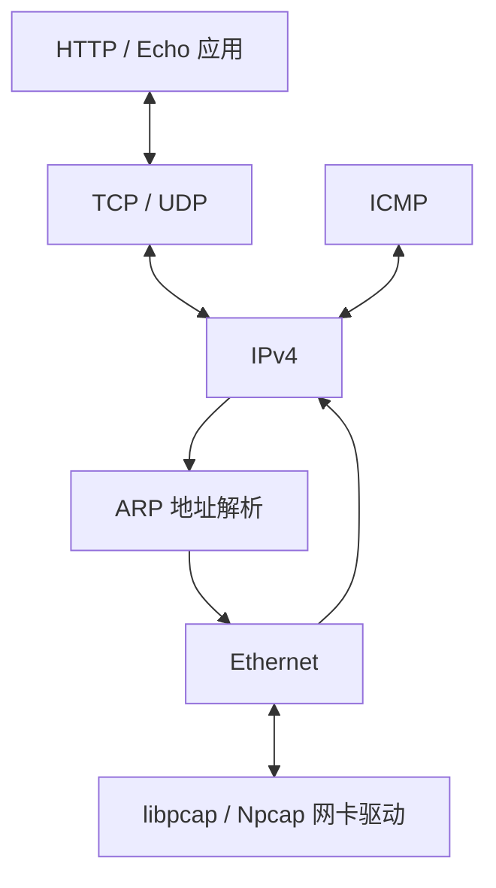

# Network Stack Lab · 用户态网络协议栈

[简体中文](README.md) | [English](README_EN.md)

使用 **C + libpcap/Npcap** 实现分层网络协议实验，从以太网帧收发、ARP 地址解析、IPv4 封装与分片，逐步连接 ICMP、UDP、简化 TCP 和静态 HTTP 服务。

项目聚焦一条具体链路：**应用数据如何逐层封装成网络帧，以及收到的帧如何回到应用回调**。

## 协议与功能

| 层次 | 实现内容 |
| --- | --- |
| 链路访问 | 网卡选择、pcap 收发、BPF 过滤与非阻塞轮询 |
| Ethernet | 帧封装、协议分发与最小帧填充 |
| ARP | 请求/响应、IP–MAC 缓存、解析期间的待发送报文缓存 |
| IPv4 | 首部检查、校验和、目的地址判断与发送分片 |
| ICMP | Echo Reply，以及协议/端口不可达报文 |
| UDP | 报文校验、伪首部校验和、按端口注册回调 |
| TCP | 面向服务端的简化连接状态机、握手、数据回调与关闭处理 |
| HTTP | GET 静态资源、默认首页、MIME 类型及 200/404 响应 |

TCP 通过连接表维护远端 IP、远端端口和本地端口，代码包含 `LISTEN`、`SYN_RECEIVED`、`ESTABLISHED`、`LAST_ACK` 等状态。这里的 TCP 定位为协议学习实现。

## 分层数据流



`net_add_protocol()` 注册协议处理函数，`net_poll()` 驱动接收循环。`buf_t` 统一处理首部、载荷和填充，`map_t` 用于协议处理表、地址缓存与连接管理。

## 应用示例

| 目标 | 行为 |
| --- | --- |
| `udp_server` | UDP 60000 端口回显 |
| `tcp_server` | TCP 60000 端口回显 |
| `web_server` | 80 端口 GET 服务，资源来自 `app/resource/` |

HTTP 示例将请求路径映射到本地文件，分段读取内容，再通过自定义 TCP 接口发送，用于展示应用层与协议栈的衔接。

## 构建与使用

需要 C 编译器、CMake 和 libpcap 开发库；Windows 构建分支链接 Npcap，仓库包含其 SDK 目录。

```bash
git clone https://github.com/VincentLucifer/HITSZ_Protocal_Stack_Lab.git
cd HITSZ_Protocal_Stack_Lab
cmake -S . -B build
cmake --build build
```

运行实网示例前，在 `include/config.h` 配置 `NET_IF_IP` 和 `NET_IF_MAC`。协议栈使用独立于宿主机的地址：选择同网段、未被占用且不等于宿主网卡的 IP。驱动按网段匹配网卡。

在 Linux 中选择一个示例运行：

```bash
sudo ./build/udp_server
# 或
sudo ./build/tcp_server
# 或
sudo ./build/web_server
```

从同网段客户端连接配置的协议栈地址。HTTP 使用 `http://<NET_IF_IP>/`；UDP/TCP 示例使用 60000 端口。

## 测试组织

CMake 注册了 Ethernet 输入/输出、ARP、IP、IP 分片、ICMP、UDP、TCP 八组 CTest。测试使用 `testing/faker/` 替换部分下层组件，并通过 `testing/data/` 的报文与日志组织输入输出。

```bash
ctest --test-dir build --output-on-failure
```

## 代码导航

| 路径 | 职责 |
| --- | --- |
| `src/driver.c` | 网卡发现、过滤与收发 |
| `src/ethernet.c` / `src/arp.c` | 链路封装与地址解析 |
| `src/ip.c` / `src/icmp.c` | 网络层与控制报文 |
| `src/udp.c` / `src/tcp.c` | 传输层 |
| `src/buf.c` / `src/map.c` | 缓冲区与映射容器 |
| `include/` | 报文结构、接口与配置 |
| `app/` | Echo 与 HTTP 示例 |
| `testing/` | 协议级测试与数据 |

## 技术关注点

网络字节序与校验和、跨层缓冲区操作、ARP 缓存与延迟发送、IP 分片偏移、TCP 状态转换，以及通过替换下层组件隔离协议测试。

本项目为 HITSZ 计算机网络课程实验，保留课程框架与配套测试的组织方式。
