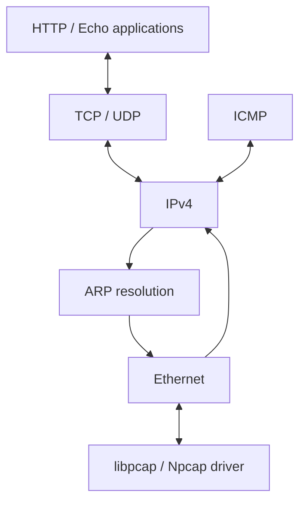

# Network Stack Lab · A Userspace Network Stack

[简体中文](README.md) | [English](README_EN.md)

Layered networking experiments in **C with libpcap/Npcap**, connecting Ethernet I/O, ARP resolution and IPv4 encapsulation/fragmentation with ICMP, UDP, a simplified TCP implementation and a static HTTP server.

The focus is concrete: **how application data becomes a network frame, and how received frames reach application callbacks**.

## Protocols and features

| Layer | Implementation |
| --- | --- |
| Network access | Interface selection, pcap I/O, BPF filtering and non-blocking polling |
| Ethernet | Frame encapsulation, protocol dispatch and minimum-frame padding |
| ARP | Requests/replies, IP–MAC caching and pending packets during resolution |
| IPv4 | Header validation, checksums, destination checks and outbound fragmentation |
| ICMP | Echo replies and protocol/port-unreachable messages |
| UDP | Validation, pseudo-header checksums and port-based callbacks |
| TCP | Simplified server-side connection states, handshake, data callbacks and closing |
| HTTP | Static GET resources, default index, MIME types and 200/404 responses |

TCP identifies connections by remote IP, remote port and local port. States include `LISTEN`, `SYN_RECEIVED`, `ESTABLISHED` and `LAST_ACK`. Its scope is protocol education.

## Layered data flow



`net_add_protocol()` registers handlers and `net_poll()` drives reception. `buf_t` handles headers, payloads and padding; `map_t` supports protocol tables, address caches and connections.

## Applications

| Target | Behaviour |
| --- | --- |
| `udp_server` | UDP echo on port 60000 |
| `tcp_server` | TCP echo on port 60000 |
| `web_server` | HTTP GET on port 80, serving `app/resource/` |

The HTTP example maps paths to local files, reads content in chunks and sends it through the custom TCP API, connecting application logic to the stack.

## Build and usage

Requires a C compiler, CMake and libpcap development libraries. The Windows build links Npcap; its SDK directory is included.

```bash
git clone https://github.com/VincentLucifer/HITSZ-Protocol-Stack-Lab.git
cd HITSZ-Protocol-Stack-Lab
cmake -S . -B build
cmake --build build
```

Before live networking, configure `NET_IF_IP` and `NET_IF_MAC` in `include/config.h`. The stack uses an address separate from its host: select an unused IP on the same subnet, different from the host interface address. The driver selects an interface by network-prefix matching.

Choose one example on Linux:

```bash
sudo ./build/udp_server
# or
sudo ./build/tcp_server
# or
sudo ./build/web_server
```

Connect from a client on the same subnet. HTTP uses `http://<NET_IF_IP>/`; UDP/TCP examples use port 60000.

## Test organisation

CMake registers eight CTest groups: Ethernet input/output, ARP, IP, IP fragmentation, ICMP, UDP and TCP. `testing/faker/` substitutes selected lower-layer components, while packet fixtures and logs live under `testing/data/`.

```bash
ctest --test-dir build --output-on-failure
```

## Code map

| Path | Responsibility |
| --- | --- |
| `src/driver.c` | Interface discovery, filtering and I/O |
| `src/ethernet.c` / `src/arp.c` | Link-layer framing and address resolution |
| `src/ip.c` / `src/icmp.c` | Network layer and control messages |
| `src/udp.c` / `src/tcp.c` | Transport layer |
| `src/buf.c` / `src/map.c` | Buffers and mapping containers |
| `include/` | Packet structures, interfaces and configuration |
| `app/` | Echo and HTTP examples |
| `testing/` | Protocol tests and fixtures |

## Technical focus

Network byte order and checksums, cross-layer buffer manipulation, ARP caching and deferred transmission, fragmentation offsets, TCP state transitions and protocol testing through lower-layer substitution.

This is a HITSZ computer-networking lab, retaining the course framework and associated test organisation.
